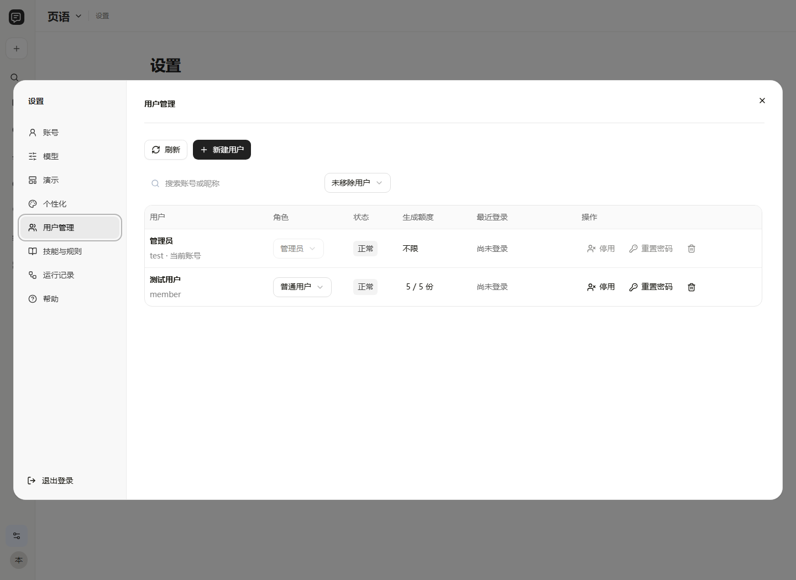

<p align="center"></p>

# 页语 Yeyu

**基于 Hermes 的可编辑 PPTX 智能体工作台。用自己的文档、模板和原生素材，生成演示稿，再围绕每一页对话修改。**

[English](README.en.md) · [安装](docs/installation.md) · [架构](docs/architecture.md) · [配置](docs/configuration.md) · [贡献](CONTRIBUTING.md)

[完整使用说明书](docs/manual/software-manual.md) · [软件说明书与源程序材料](docs/software-copyright.md)

[](https://github.com/Donotdream1/yeyu-ppt-agent/actions/workflows/ci.yml)
[](LICENSE)

## 能做什么

| 能力 | 实现 |
| --- | --- |
| 文档到演示稿 | DOCX、文本 PDF、TXT、Markdown、粘贴内容；规划主题、章节、逐页标题和要点。 |
| 复用原生素材 | 解析单页 PPTX、文字槽、组合、连接线、表格和支持的原生统计图；保留素材原色与编辑结构。 |
| 逐页对话 | 修改当前页文案、布局和图形；上传照片、指定位置，支持选中部分对象后修改。 |
| AI 推荐换版 | 按内容关系、模块数和文字容量推荐5个现有素材页面；刷新换一轮，可人工接入失败页。 |
| Hermes Skills | 写作、图表、素材使用、版式与质检分工；页面有界并发、断点继续、局部修复，Office操作串行。 |
| 版式与技能 | 上传参考 PPTX 或提示词，读取整套样式；可编辑规则并在新作品中复用。 |
| 私有模型连接 | 每用户保存独立连接；支持 DeepSeek、OpenAI 及兼容 Chat Completions 的服务，Key 加密、测试和切换。 |
| 项目与账号 | 项目文件夹、最近作品、回收站、注册验证码、管理员用户管理与生成额度。素材库仅管理员可查看。 |

预览缩略图使用图片，**演示稿中的原生素材不会被整页截图替代**。原素材本身是照片时仍保留为照片，不能自动变成可编辑矢量。数据图需要真实数据和口径；不从截图猜数。

## 快速开始

完整流程目前以 **Windows + 桌面版 Microsoft PowerPoint** 验证。需要 Node.js ≥22.12、Git、[uv](https://docs.astral.sh/uv/getting-started/installation/)，安装脚本默认 Python 3.14。

```powershell
git clone https://github.com/Donotdream1/yeyu-ppt-agent.git
cd yeyu-ppt-agent
npm ci
Copy-Item .env.example .env
npm run setup:hermes
npm run build
npm run doctor
npm start
```

打开 **http://127.0.0.1:3210**。首个注册账号为管理员。进入“设置 → 模型”添加连接，然后导入自己有权使用的模板和素材，新建项目并上传文档。

默认支持通过本机局域网 IP 的3210端口访问；仅本机使用可设置 `BIND_ADDRESS=127.0.0.1`。首次注册、网络暴露、凭据备份和模型数据传输说明见 [安全策略](SECURITY.md)。

**仓库不包含你的个人 PPT 素材、公司 Logo、真实文档、账号数据库、API Key 或生成作品。** 这些内容需要使用者自行提供。Hermes 作为外部 MIT 运行时按固定提交下载，不把整套上游源码或本机运行环境提交进来。

## 使用流程


章节数由文档或用户目录决定，不固定四项；目录、正文编号和页眉导航保持对应。字号优先沿用素材，中文字体按用户要求统一；溢出先精简或换版。人工选定的素材默认保留；在用户已授权的溢出修复中，可换版，无适配候选时用同套系原生模块生成本页模板，再检查后导出。

普通用户默认累计成功生成5份新稿，管理员可调整；失败释放预留，修改已有作品不重复计数，删除作品不返还已使用额度。配置自己的模型 Key 不自动取消应用额度。

## 界面



图中为合成账号，展示宽屏用户管理和额度设置，不包含真实用户数据。

## 技术与目录

- 前端：React、Vite、Tailwind CSS、shadcn/ui / Radix。
- 后端：Node.js、Express、JSON持久化、OOXML / JSZip。
- 智能体：Hermes Python桥接，兼容模型服务，按页分工及断点。
- 检查：原生关系/结构检查、PowerPoint文字测量与PNG预览、数据来源和语义检查。

```text
src/                  工作台、设置、页面对话与UI组件
server/               API、账号、素材索引、编排、PPTX导出与检查
agents/skills/        写作、素材、图表、版式和质检规则
agents/vendor/        附许可证的少量Harness检查代码
scripts/              安装、诊断、Office操作与独立验证
test/                 单元、HTTP及浏览器测试
docs/                 安装、配置、架构及开发说明
data/                 本地运行数据（不上传）
```

## 开发与测试

```powershell
npm ci
npm test
npm run build
npm run check:publication
npm run test:http
```

测试应在无私人素材的干净目录运行。付费模型、真实 Office 和个人模板验收不是单元测试的一部分；浏览器/Office集成测试的前置条件见 [开发文档](docs/development.md)。连接测试会调用所填服务，可能产生少量服务商费用。

## 当前边界

新增[模板适配与协作演示](docs/slides-workflow.md)：按原生文本槽容量编排，区分可复用底稿与完整参考稿；支持按需求从素材库生成可复用模板、主题初稿、账号权限协作、逐页评论与同步翻页。飞书/Google提供按需发送云端副本的连接入口，需要用户自己的有效访问令牌。

- 尚未宣称支持 WPS/macOS/Linux 的同等预览与测量；当前 COM 脚本调用 PowerPoint。
- 不支持加密 PPTX、旧版 `.ppt` 或扫描 PDF 的自动 OCR。
- 任意复杂图解的语义适配、动画及跨页引用需要审阅；保留源对象不等于内容自动完美。
- 需要工具调用的流程不能由只支持纯聊天的接口替代，视觉流程还需要模型支持图片。
- 本机/LAN版本不是已经过独立审计的公网多租户SaaS。文件存储和任务调度目前面向单机。

后续方向：可复用的公开合成素材测试集、更多无Office预览适配、队列/数据库扩展和可量化的视觉回归测试。未实现项不作为现有功能承诺。

## 来源与许可证

原创代码采用 [MIT](LICENSE)。Hermes、Harness Anything、shadcn/ui及其他依赖保留各自许可证，详见 [第三方声明](THIRD_PARTY_NOTICES.md)。参考 [PPT Master](https://github.com/hugohe3/ppt-master) 的路线/参数组织及 [PPTAgent](https://github.com/icip-cas/PPTAgent) 的检查修正思路，本项目的实际执行引擎为 [Hermes](https://github.com/NousResearch/hermes-agent)。

欢迎通过 [Issues](https://github.com/Donotdream1/yeyu-ppt-agent/issues) 反馈问题或提交改进。请使用可公开的合成示例，勿上传密钥或客户文档。
