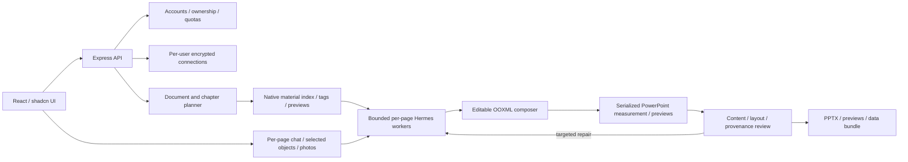

# Architecture

Yeyu separates document planning, material retrieval, page writing, native PPTX
composition and validation. Hermes is the execution engine; a compatible model
provider supplies reasoning and tool calls.

## Main modules

| Directory/file | Responsibility |
| --- | --- |
| `src/App.jsx`, `src/hooks/use-studio.jsx` | Workspace navigation, generation state and page interactions. |
| `src/components/workspace/` | Projects, history, model settings, material library, Skills, page agents and administration. |
| `server/local-auth.mjs`, `generation-quota.mjs` | Sessions, ownership, roles and atomic quota reservations. |
| `server/model-connections.mjs` | User-isolated encrypted credentials and asynchronous request context. |
| `server/hermes-parallel.mjs` | Planning, bounded page workers, progress and checkpoint coordination. |
| `server/native-layout-workflow.mjs` | Fill complete uploaded reference pages while keeping native geometry and styles. |
| `server/hermes-client.mjs`, `agents/hermes_worker.py` | Node/Python bridge to the external Hermes runtime. |
| `server/material-*.mjs`, `recommendations.mjs`, `visual-selection.mjs` | Parsing, tagging, capacity/structure checks and candidate selection. |
| `server/composition.mjs`, `ooxml.mjs`, `native-charts.mjs` | Editable native shapes, relationships, tables and chart workbooks. |
| `server/native-text-fit.mjs`, `scripts/*.ps1` | PowerPoint text measurement and previews, serialized to avoid concurrent Office conflicts. |
| `agents/skills/` | Writing, material use, chart drawing, page editing, style and quality rules. |

## State and boundaries

Runtime state lives in ignored `data/` subdirectories. Source PPTX imports are
copied locally; templates and generated outputs have separate records. Project
directories hold user-selected source/output files. Preview PNGs are for display,
not a substitute for native slide content.

New decks reserve quota before expensive generation. A successful root deck
consumes one unit; failures release reservations. Page edits and versions of
owned decks do not consume another new-deck unit. Permanent deletion does not
refund consumed units. Model connections are resolved per user and carried into
queued asynchronous jobs so keys do not cross user boundaries.

One page has an isolated content/design task. Office operations share a serial
queue. Checkpoints preserve accepted pages; failures repair only affected pages.
Manual material choices take priority over automatic replacement. UI completion
is based on actual exported results and checks, not model prose.

Native editability depends on the source object: a real photo stays a photo;
native chart data is editable when a supported chart is bound. An exported PNG
or SVG alone does not prove a native Office chart exists.

Template slot contracts, topic drafts and in-app collaboration are described in
[the slides workflow](slides-workflow.md). `template-slot-contract.mjs` derives
capacity from inherited native geometry and typography. `collaboration.mjs`
stores membership, comments and versioned presenter state; authenticated SSE
publishes curated snapshots. Viewers receive previews rather than raw source
plans. Editors reuse the existing page agent and document-lock pipeline.
`slides-connectors.mjs` optionally sends explicit cloud copies with request-scoped
tokens; it does not change local permissions or replace the original export.
