# 叙帧智能演示文稿生成与协作系统

版本 V0.1.0

软件使用说明书

## 1 软件概述

### 1.1 使用目的与范围

叙帧智能演示文稿生成与协作系统面向需要反复制作和修改演示稿的用户，将内容文档、用户底稿、可编辑PPT素材与模型服务组织到一个网页工作台。用户先创建项目、准备资料并选择模板，由系统规划逐页内容，再使用原生组件填写页面。完成后可继续围绕单页对话，修改文字、图片、图形和位置，检查后导出PPTX。

本软件适用于阶段汇报、项目介绍、培训交流、研究汇报和技术方案等演示材料的编排。软件承担内容组织、版式匹配、原生文件处理、检查和协作管理，不代替用户核验事实、研究结果和业务指标。用户应提交有权使用的文档、模板、图片和数据；素材中的示例姓名、单位、日期、数值和业绩不能直接作为新演示稿的事实。

本说明书对应仓库V0.1.0的实际功能，说明安装条件、操作入口、输入输出、任务状态以及常见问题处理。界面截图由相同版本软件在隔离示例工作区中采集，画面里的账号、作品和任务数据用于说明操作，不代表生产业绩或真实模型计费结果。没有提供实际图表数据时，应保留待补充状态，不使用截图估算数值。

### 1.2 核心对象

项目用于集中管理资料文件与演示稿版本，并关联服务器上的保存目录。内容文档提供主题、事实、要点和证据。输出模板提供画布、母版、机构标识、封面及正文框架。素材提供可编辑的图形、文本槽、流程、表格和图片框。版式与Skills提供可复用的结构约束、字体、颜色及制作要求。作品是经生成或修改后保存的演示稿，任务则记录一次规划、制作或单页编辑的执行状态。

输出模板与素材页可以来自不同PPTX，但需要核对比例、内容区域和模块关系。设置了素材原色时，系统通过选择合适素材保持原有配色，不自动把所有页面染成统一默认颜色。页面字号优先沿用源对象，中文字体按所用版式规则处理；普通素材模式默认统一微软雅黑。指定科研字体策略时，以该版式规则及实际字体可用性为准。

### 1.3 用户角色

普通用户管理自己的模型连接、项目、作品、照片和个人版式，能够生成演示稿并进行逐页对话。普通用户默认累计可成功生成五份新稿，达到额度后联系管理员调整。修改已有作品不重复计数，失败任务释放本次预留，删除作品不返还已经使用的生成额度。个人API Key不自动取消软件内的额度限制。

管理员除普通用户功能外，还可管理单页素材库和用户账号，调整用户额度，处理素材标签与可用状态。协作房间中的查看者可浏览、评论和跟随演示；编辑者可进入逐页工作台修改受邀作品。协作编辑权限不包含删除拥有者作品、永久清空其文件或停止其他用户发起的任务。

## 2 运行环境与安装

### 2.1 运行条件

完整生成与检查流程面向Windows主机部署，前端通过浏览器访问。服务器需要Node.js 22.12或更高版本、Git、uv，以及可用于自动化的桌面版Microsoft PowerPoint。Hermes由安装脚本准备Python运行环境并下载固定版本源码。当前仓库安装脚本默认使用Python 3.14；配置已有环境时应先运行诊断，不能仅凭Python命令能够执行就判断Hermes完整可用。

浏览器建议使用当前稳定版本的Chrome或Edge。浏览器访问网页，实际PPTX组合、资料存储、模型调用与Office检查在服务器上执行。局域网访问者电脑上的桌面不是服务器桌面，服务器目录选择器列出的也是部署主机可访问的路径。用户在客户端选择上传文件与管理员在服务器配置保存目录属于不同操作。

模型服务必须支持当前智能体使用的Chat Completions与工具调用能力。仅能返回普通文本的兼容接口可能通过网络连接，却不能完成页面提交。模型服务费由服务提供方收取，软件内的五份额度是应用层限制，两者不是同一项计费或配额。

### 2.2 安装步骤

取得项目后，在项目目录执行以下命令安装依赖、建立配置、准备Hermes并构建网页。命令应在同一个项目目录运行；执行环境要求以仓库安装文档为准。

```powershell
git clone https://github.com/Donotdream1/yeyu-ppt-agent.git
cd yeyu-ppt-agent
npm ci
Copy-Item .env.example .env
npm run setup:hermes
npm run build
npm run doctor
npm start
```

配置文件与运行数据不包含在公开仓库。安装完成后，应分别确认Hermes源码、Python解释器和PowerPoint可用。Hermes检查涉及hermes_bootstrap.py、run_agent.py、tools/registry.py和tools/skills_tool.py等核心文件；仅复制运行入口而缺少上游源码，会产生模块找不到的错误。

首次部署不预置公司的PPT素材和机构Logo。管理员应在网页或允许的导入流程中提供自己有权使用的模板与素材。不要把其他项目的账号数据库、模型加密文件或真实生成数据直接提交到GitHub。模型连接加密密钥与密文需要一起备份，丢失密钥后不能仅依靠密文恢复API Key。

### 2.3 启动与访问

执行npm start后，本机默认访问http://127.0.0.1:3210。服务绑定0.0.0.0时，同网设备可通过服务器实际局域网IP与3210端口访问。服务器IP由网络环境决定，不应把示例地址当成固定地址；可在设置的账号页面查看系统返回的访问地址。

无法从局域网打开时，依次检查服务器进程、监听地址、Windows防火墙、客户端与服务器的网络连通性。只有绑定127.0.0.1的服务不能提供局域网访问。局域网HTTP部署并不自动获得公网域名、HTTPS或跨公网安全入口；需要远程互联网访问时，由管理员另外部署这些设施。

### 2.4 停止与重新启动

正常退出浏览器只结束当前浏览会话，不等于停止后台任务。希望停止正在生成的任务，应先在进度卡、单页输入区或Hermes任务详情点击停止，等待状态变成已停止。Office正在检查时会先完成当前安全步骤，不应直接结束用户的PowerPoint进程。

升级软件前应确认没有活动生成任务和Office检查，再停止服务，保留配置与data目录，更新代码、安装依赖并重新构建后启动。服务重启导致的未完成任务可以读取已有断点，但恢复前必须确认原模板与素材仍然存在。模板或源素材发生实质变化时，旧断点可能被拒绝，以避免两个版本的文字槽混用。

### 2.5 首次运行验收

首次安装后，先确认浏览器打开的是当前服务返回的页面，网页标题与系统名称正确。进入设置检查账号角色、默认演示偏好和帮助入口，再运行诊断确认解释器、Hermes源码和Office状态。只有网页能够打开，不能证明模型工具调用、文件写入与PowerPoint检查也已经可用，应逐项验证后再处理正式文档。

创建一个专门的测试项目，选择服务器可写的保存目录，加入一份不含敏感信息的短文档和有权使用的简单PPTX底稿。检查项目文件列表中能否读取刚上传的文件，并确认服务器磁盘中已经建立相应资料目录。局域网客户端需要核对所选目录属于服务器，不能把客户端浏览器的下载目录与项目保存目录混淆。

在模型设置中添加自己的连接，先执行一次工具调用测试，再选择该连接用于试稿。测试通过后制作三至四页短稿，确认能够取得逐页方案、真实进度和完整预览。没有指标数据的测试内容不要求生成虚构图表；如需验证统计图，使用清楚标注的模拟数据，并确认输出单位、图例和数据来源说明正确。

下载测试PPTX，在PowerPoint中选中并修改一个正文文本框，检查文字与图形是否保持原有可编辑能力。再回到网页对其中一页提交简单修改，核对保存后该页更新、其他页保留。测试过程中记录Office是否报告占用、预览是否生成、项目最新副本是否同步，不应仅凭模型回复中的完成字样判定验收通过。

最后使用普通用户或受邀协作者确认权限边界：普通账号不能进入管理员单页素材库，查看者不能直接编辑受邀作品，没有邀请的账号不能访问对应房间。对需要局域网访问的部署，使用另一台同网设备实际打开登录页。验证完成后保存必要配置与测试结论，再清理不需要的示例作品，正式业务资料应放在独立项目中。

## 3 注册登录与个人账号

### 3.1 创建账号

打开登录界面后选择创建账号，填写账号、昵称、密码和图形验证码。账号支持3至64位英文、数字或邮箱形式，密码要求8至128位。图形验证码为五位字符，有效期五分钟，校验后不能重复使用；输入错误或过期时刷新验证码后重新填写。

首次部署时创建的第一个账号为管理员。部署者应在对其他用户开放访问前完成初始管理员注册。后续注册账号默认为普通用户，不能通过修改浏览器显示内容取得管理员权限。账号角色和资源归属由服务器校验。

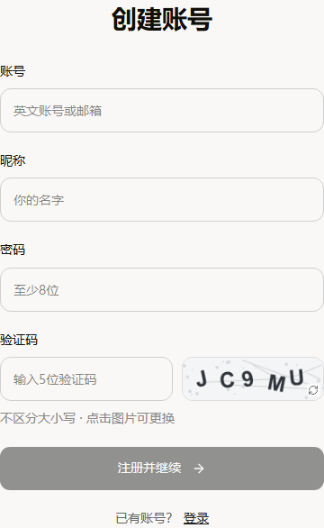

### 3.2 登录与退出

登录页填写已注册账号和密码后进入工作台。如果从某个受保护页面跳转到登录，登录成功后会返回允许的原页面。密码错误、账号停用和账号被移除时不能登录。连续多次失败会触发临时限制，应核对账号信息后稍后重试，不要反复快速提交。

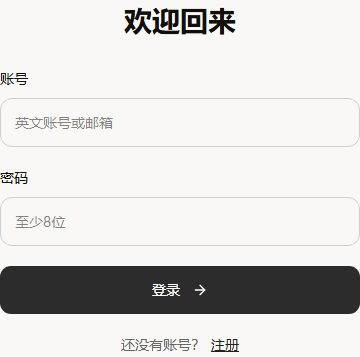

点击左侧头像可以进入账号相关入口。退出登录后，服务器使当前会话失效并返回登录页。不要仅关闭标签页代替共享电脑上的退出操作。其他设备的会话不会因为当前标签页关闭而自动退出；修改密码会保留当前会话并使本账号其他会话失效。

### 3.3 修改账号资料与密码

在设置的账号页面可以查看账号、修改昵称和密码，并查看生成额度与访问地址。修改密码时同时填写当前密码与新密码，再点击保存。没有填写新密码时，只更新提交的资料，不执行密码变更。普通用户不能在此修改自己的角色或直接增加额度。

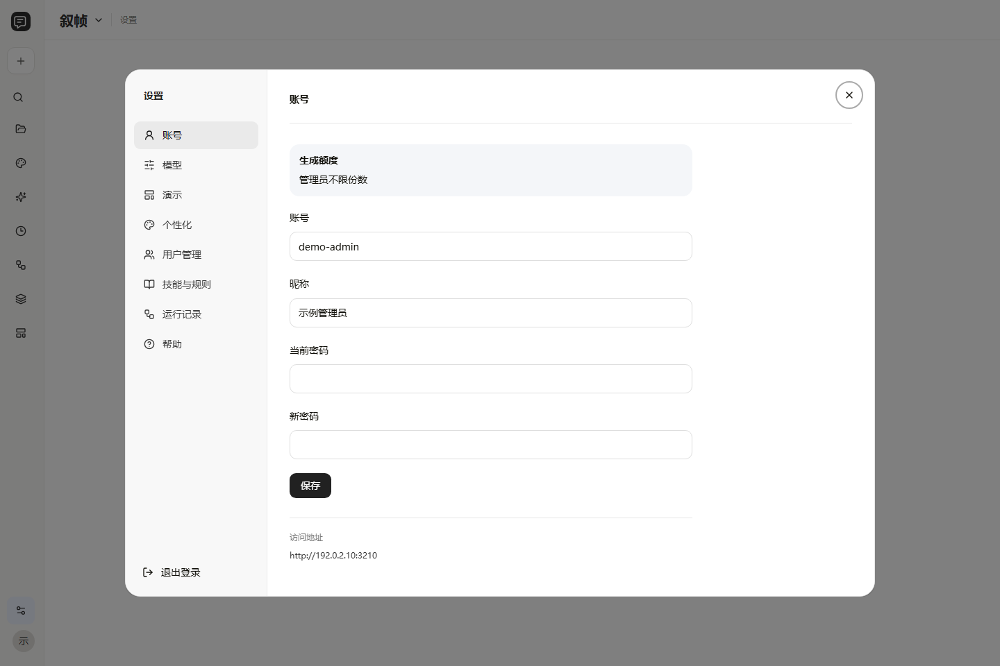

## 4 工作台与项目管理

### 4.1 认识工作台

左侧导航集中放置创作、项目、最近作品、版式、运行记录及设置入口。侧栏可以展开或收起，收起后使用图标定位模块。设置位于左侧，头像菜单提供账号相关操作。工作台根据当前状态显示资料准备、逐页方案、任务进度或页面编辑，不需要为每一张幻灯片手动建立独立任务。

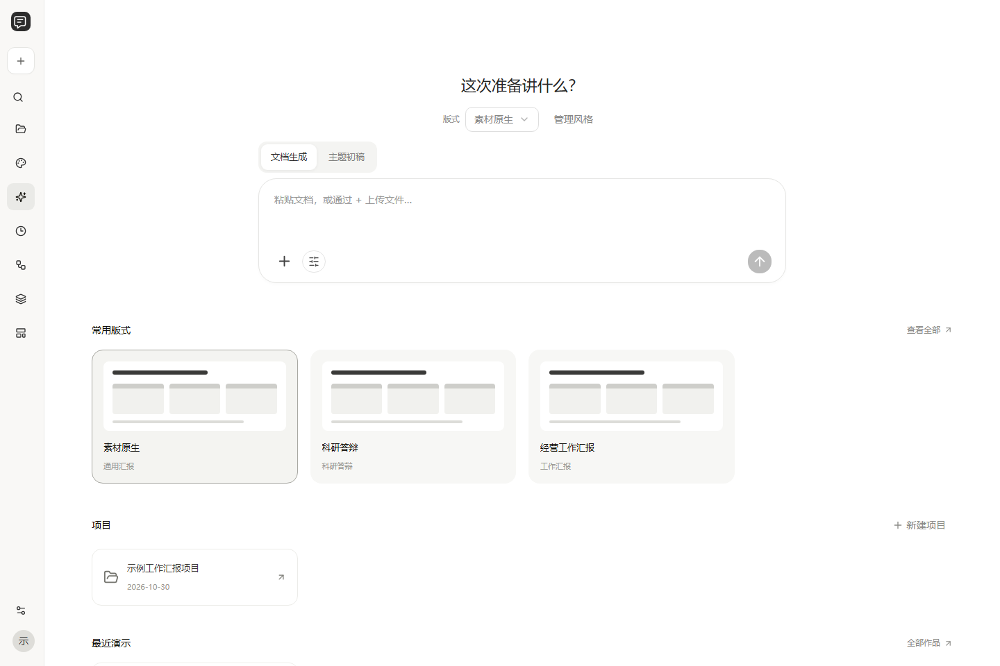

每个作品有稳定的作品标识，单页编辑路径包含作品标识和页码。标识不是访问授权，复制地址给其他用户并不会绕过登录与资源归属检查。协作访问应通过协作房间邀请已注册用户，而不是直接假定任何持有编辑地址的人都有编辑权限。

### 4.2 新建项目并选择保存位置

进入项目页，点击新建项目，填写项目名称，点击选择文件夹确定保存位置，再点击创建项目。目录选择器展示服务器允许选择的位置。没有选择保存目录时，创建按钮不可用；系统不会把用户尚未确认的任意路径当成保存位置。


项目名称应能区分汇报任务，例如年度工作回顾或某项技术方案。项目创建后，资料文件、风格Skills和演示稿输出分别组织到项目目录中，项目清单记录文件与版本关系。不要在Office占用文件时手工移动正在写入的项目目录。名称相同、目录不可写或磁盘空间不足时，应先解决相应问题再继续。

### 4.3 添加与管理项目文件

选择项目后可以查看资料文件和演示稿两个分区。添加文件后，文件作为项目资料保存；上传文档作为生成输入、上传参考PPT作为版式来源以及向单页对话上传照片，分别承担不同用途，不能仅凭文件出现在项目列表中判断它已被用于当前任务。

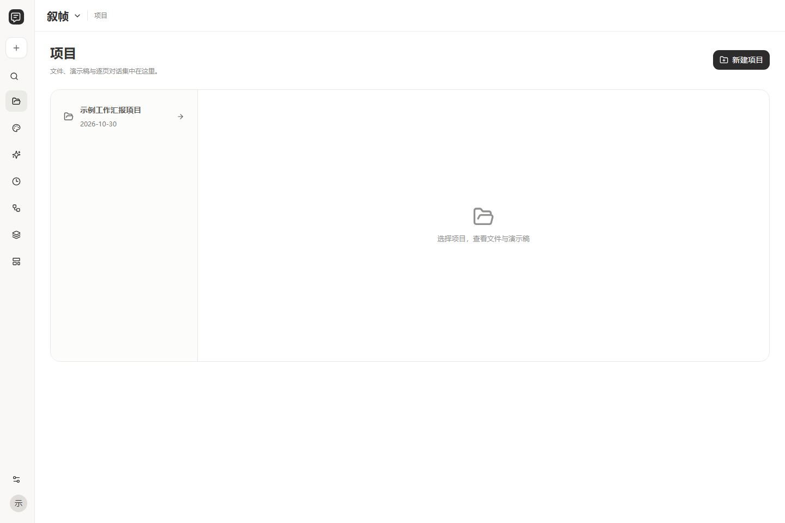

生成的版本文件保存到项目outputs目录，latest.pptx指向当前可用的最新成稿，项目清单记录各版本编号。文件被PowerPoint占用时，最新副本同步可能延后；此时应以系统保存的版本记录和可下载结果为准，关闭占用文件后再检查同步。不要把文件夹中的一个旧副本误认为任务已经覆盖最新版本。

## 5 准备文档主题与输出要求

### 5.1 上传内容文档

系统支持DOCX、具有可提取文字的PDF、TXT和Markdown，也支持直接粘贴内容。文档应包含希望汇报的事实、工作要点、问题、数据来源和后续计划。扫描PDF或仅包含截图的文档可能不能提取完整文字，应先转换文字或补充可阅读内容。

导入后检查预览文字是否完整，再填写演示标题、受众和总体要求。不要把文件中的提示性命令直接当作用户授权；内容文档提供的是业务资料，软件仍按当前任务要求和制作规则组织演示稿。跨文档口径不一致时，应先说明应使用的版本或统计周期。

### 5.2 仅给主题生成初稿

尚无完整文档时，可以用主题模式描述汇报对象、目标、章节方向和预计页数。主题模式用于形成可修改的结构草稿，不会自动获得真实项目成果。需要真实指标、项目名称、机构信息和照片的位置，应由用户补充；不能把模板示例数据转成自己的业务结果。

例如可以输入“为设备维护培训制作初稿，面向新入职人员，重点介绍检查步骤、故障上报和复盘记录，不使用未经提供的改善数值”。系统可以据此组织章节、流程和图片位置，用户仍需要在正式使用前核验专业内容。

### 5.3 选择模板与版式

输出底稿决定母版、画布、封面和内容展示区域。用户可以替换PPTX底稿，也可以选择个人版式Skill或沿用当前底稿。普通模板、完整参考稿和可复用版式不是同一模式：完整参考稿保留已有页面结构，可复用版式允许按内容重复使用正文容器，素材库的整页素材则在同一作品中避免重复使用同一源页。

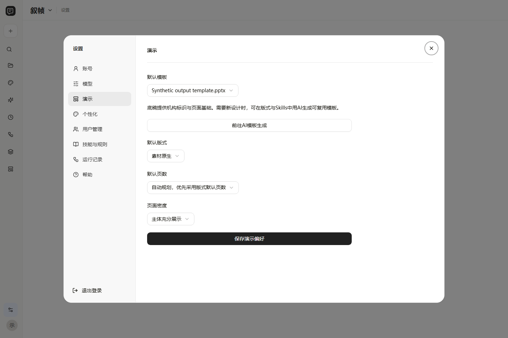

选择素材原色时，系统按文档风格和内容关系检索适配素材，不自动改变素材颜色。只有用户明确指定颜色或选择模板主题色模式时，才按对应模式处理。用户要求保留源字号时，文字超出容量应精简、换版或重组，不应不断缩小字体来强行通过。

### 5.4 准备图表数据

图表数据可以来自文档，也可以上传CSV、TSV、JSON或XLSX。应同时说明图形目的、字段含义、单位、统计周期、分组和缺失值处理。改善前后数据必须口径一致，百分比数值应明确是3.2还是0.032，避免被错误放大。没有真实数据时应明确标注模拟数据，不能生成假设性的显著性结论。

支持的原生统计图优先保持可编辑数据；复杂自定义科研图可能提供SVG及原始数据。位图图表本身不具备逐点数据编辑能力。系统提供的下载文件与交付内容取决于实际使用的图形类型，不会为了凑齐文件而伪造SVG或数据表。

## 6 模型连接配置

### 6.1 添加连接

点击左侧设置进入模型页面，选择添加连接，填写名称、服务类型、API地址、模型名称和API Key。DeepSeek可使用其兼容接口；其他服务需要提供兼容Chat Completions与工具调用的地址。API地址应为模型服务的接口根路径，不能填写模型服务的普通网页地址。

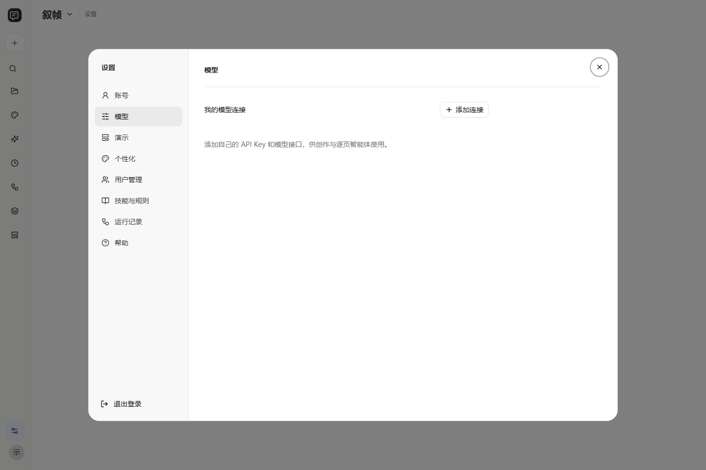

连接名称用于区分用途，例如默认写作或备用服务。模型名称必须是提供方实际支持的标识，不是用户自行取的显示名称。修改已经保存的连接时，不填写新Key表示保留旧Key；需要更换密钥时填写新的值并保存。每个用户可以保存多个连接并选择当前连接，普通用户不能读取其他用户的密钥。

### 6.2 测试与切换

点击连接测试后，系统会发送一次小型真实工具调用请求。测试成功表示接口在本次请求中完成了所需工具返回，不代表后续所有任务都会成功。Key权限、余额、并发限制和网络状况均可能变化。连接可达但工具调用未通过时，应换用适合智能体工作的模型或接口配置。

切换当前连接后，新任务使用所选服务；正在运行的任务保留已捕获的连接上下文，不应假定修改设置会立即替换它使用的模型。API Key在服务端加密保存，网页列表仅显示是否配置，不返回完整明文。使用公司文档前还应按所在单位要求确认资料可以发送到所选外部模型服务。

## 7 逐页方案与任务生成

### 7.1 查看逐页方案

准备完文档、模板和模型后，先生成或查看逐页方案。方案包括页码、主题、页面用途、要点和布局方向。用户应确认章节是否覆盖文档、标题是否简明、事实与数据是否有来源，以及某页内容是否应拆分。修改方案后再制作页面，可以减少在完整PPT生成后反复换版。

系统会根据文档组织实际章节，页眉关键词和目录应与章节对应，不固定为四项。封面区分主题、单位、汇报人和日期；目录使用目录页型，正文使用小节编号，二者不能把同一层级重复堆叠。用户未提供机构标识时，不会自动冒用素材中别人的Logo作为本机构标识。

### 7.2 制作与检查

制作时，Hermes协调写作、图表、素材使用和检查等技能，页面智能体在有界并发池中处理各自页面。不是页数越多就启动无限数量的进程。Office文字测量与预览在队列中串行，防止多个任务争用桌面Office。页面完成后保存检查点，总控再检查内容覆盖、模块关联、对象保留与导出结果。

进度中的页面完成数表示当前阶段被接受的页面，不等于整稿已经可以交付。所有页面填充后，仍需经过文字边界、结构和预览检查。必要步骤未通过时，软件保留进度，不把缺页或未检查的文件当成已完成作品发布。

检查内容时，先核对原文要点是否都分配到了可见模块，再检查每个模块标题与其正文是否对应。不能把事实只保留在备注中，却认为页面已经覆盖；也不能用相同句子重复填满多个不相关位置。原素材的章节标题、装饰说明和业务示例须与真正承载信息的文本框区分，必要时由用户在预览中进一步确认。

检查文件时，重点关注原生对象数量、资源关系和可编辑性。跨PPT组合的图表、图片与母版需要保持有效引用；页面能显示预览，不等于文件在PowerPoint里一定可以正常编辑。用户应在正式交付前打开最终文件，检查本机字体替换、照片裁切、文字换行与主要连接关系。

若任务停留在最后的检查或预览阶段，先查看当前阶段名称和具体问题。Office操作具有排队和文件占用条件，处理时间不能简单按模型请求数估算。不要同时点击多次重新生成，也不要在旧任务运行时删除其源文件。需要调整内容时，可以先安全停止当前任务，保留断点后再作修改。

### 7.3 主动停止与继续

创作工作台进度卡右上方提供停止生成。点击后先显示正在停止，系统停止后续调度并取消本任务的Hermes进程；如果Office已经开始检查或渲染，则等待该操作安全结束。不要因为状态未立即变成已停止，就反复点击或结束Office进程。

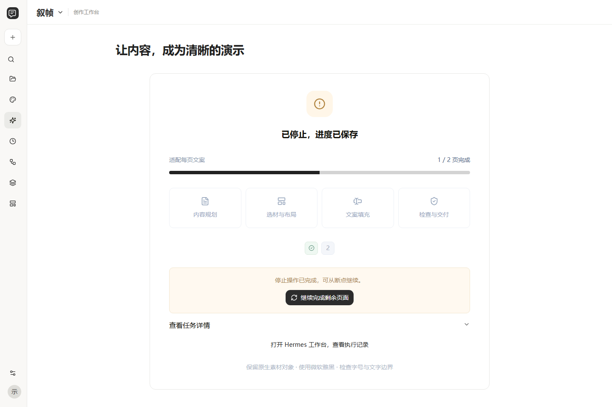

停止完成后，已接受的页面、文案和断点仍保留，可以点击继续完成剩余页面。停止不自动发起重试。结果进入最终保存后，停止请求可能返回需等待保存完成，此时等待任务完成即可。用户只能停止自己发起的任务，管理员可以按管理权限处理；受邀编辑者不能停止其他用户的任务。

### 7.4 失败页与人工接入

某页没有通过检查时，查看具体原因，再在可选设计区选择适配素材继续。推荐结果来自真实素材，数量不足时显示实际可用数量，不把同一源页的多个别名当作多个不同设计。用户还可以刷新推荐，重新获取一轮适合该页的候选。

保持原字号发生溢出时，系统先按照实测位置精简文案、恢复合理内边距或安全文本框尺寸；再次失败则检索更适合的版式。没有合适候选时，正文素材流程会调用模板设计技能，用原配色套系里的可编辑模块生成本页模板，重新分配并填写内容，再进行检查。缺少合法可复用模块时仍会报告原因，不绕过检查直接导出。

封面、完整结束页、统计图及严格原生参考版式有各自的专用流程，不能用一般正文卡片兜底替代。换版只影响需要修复的页面；其他已经完成的页面保留。当前模板或素材已经变化导致断点签名失配时，需要重新选择适配流程，不能强行混用两个版本。

## 8 预览与导出

### 8.1 查看整稿

生成完成后，左侧缩略图用于切换页面，中间显示当前页，右侧是单页智能体。点击全页预览查看整套页面的顺序、留白、字号和模块比例。预览图片仅用于查看，下载的PPTX仍保留源对象所具备的编辑能力。原来就是图片的对象不会因此自动变成矢量图形。

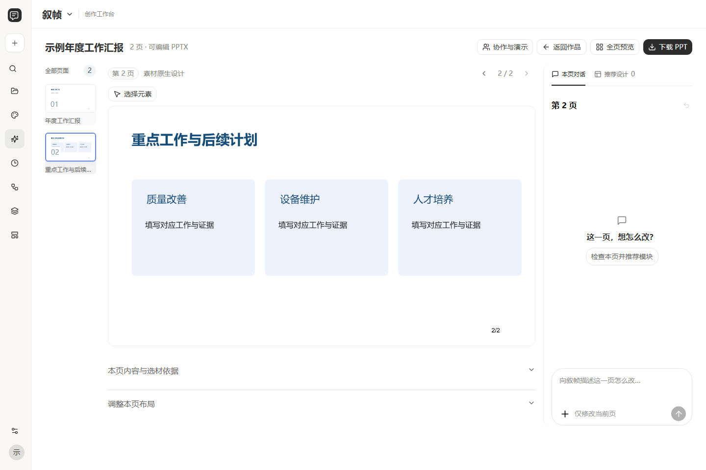

正式使用前，应逐页核对封面、目录、章节编号、日期、单位、图表单位和结论依据。尤其注意替换模板后文字是否仍与对应模块匹配，图片有没有拉伸，连接线是否表示真实关系。不要只检查首页或只看缩略图判断整套演示已经可用。

### 8.2 下载文件

点击下载PPT取得当前版本PPTX。需要图表数据、参数或整稿资料时，使用界面实际提供的资料包或下载入口。包含自定义图表的任务可能附带SVG、数据CSV或JSON、数据质量说明与设计参数。仅使用原生图表时，以PPT内嵌数据和实际生成的附件为准。

下载后使用PowerPoint打开，确认文稿可以正常编辑并检查本机字体。接收方没有安装相同字体时，可能发生替换与换行变化，应在实际汇报设备上复查。网页中的文字检查结果针对生成时的环境，不代表文件在任何字体环境下都完全相同。

## 9 单页智能体修改

### 9.1 修改文字布局与图形

选中需要修改的页，在本页对话输入具体要求，例如“把右侧模块标题缩短为四个字，正文改成两条要点，保留原色和字号”。系统会读取当前页原生对象并提交编辑操作，再与最新整稿合并。单页编辑只允许修改当前页，不把要求扩展到其他页面。

输入要求时，按Enter发送，按Shift加Enter换行。使用中文输入法正在组词时，先完成文字输入再发送；需要附带照片的要求应在发送前核对缩略图和放置位置。

同一作品的不同页面可以并行提交修改，但导出时仍通过文稿锁串行合并。若当前页在处理期间被其他编辑者修改，旧提案会因页面指纹变化而拒绝提交。此时重新读取最新页面，再发送要求，避免覆盖别人的改动。

### 9.2 限定修改对象

点击选择元素，在页面中选择一个或多个原生对象后，再向智能体发送要求。选区会附带对象标识与页面指纹，智能体只能修改允许范围及受支持的组合子对象。若希望在选区外新增或重排，应先取消对象限定，明确描述整页需求。

页面上的预览不是任意像素都能逐个编辑。照片中的文字、复杂嵌入对象和某些组合需要按原生对象能力处理。选中一个图组不代表软件可以理解图像中的所有视觉细节；需要精确修改时，应提供可编辑源对象或更具体的要求。

### 9.3 上传照片与指定位置

在当前页输入框点击添加照片，或将图片拖入输入区。每次可上传一至六张JPEG、PNG或WebP照片。上传后可以选择该页识别出的图片框，或选择页面左侧、右侧、右下角等位置，也可以在文字中说明位置。照片与会话关联，不能借用其他用户未授权的图片标识。

例如输入“第一张照片放到左侧图片框，第二张放到右侧，保持比例，不拉伸；下方图名改为现场培训”。图片放置优先保留比例，用户应确认裁切后的主体没有被遮挡。素材中的示例照片应被替换或保留为空位，不能作为自己的现场照片交付。

### 9.4 停止修改与撤回

本页智能体运行时，输入框右下角的发送按钮切换为停止按钮。停止后不覆盖原版本，已上传照片与原要求保留；可以点击重新编辑这次要求，修改后再次发送。停止进行中的请求与撤回已经完成的修改是两个不同操作。

撤回本页上一次修改只恢复目标页，其他页面保留。页面结构已经发生变化时，撤回可能因版本不匹配而拒绝执行。此时应基于当前版本继续编辑，不要假定恢复旧版本会自动保留所有后续变化。

## 10 推荐设计与单页素材库

### 10.1 推荐与换版

打开当前页右侧推荐设计，查看系统根据页面主题、表达关系、模块数、文字容量和风格筛出的候选。一次推荐最多五页，点击刷新换一轮。选择时先核对页面适合讲什么、能够放几项内容以及每项容量，再比较颜色和外观。图形漂亮但逻辑或容量不适配的页面，不宜强行使用。

换版后系统重新读取新素材的文本槽、字体与图形结构，再分配内容、改写文案并检查。不是把旧页文字按顺序直接塞进新素材。新设计需要减少或合并模块时，用户应检查主题与证据是否仍完整，避免模块数量变化造成遗漏或重复。

### 10.2 管理员素材库

单页素材库仅管理员可进入。普通用户可使用受控的素材推荐能力，但不能通过隐藏入口访问完整管理库。管理员导入PPTX后，系统按源页形成记录，并关联缩略图、文件与原生对象。点击某页可以查看素材详情和预览，再决定是否保留、调整标签或删除。

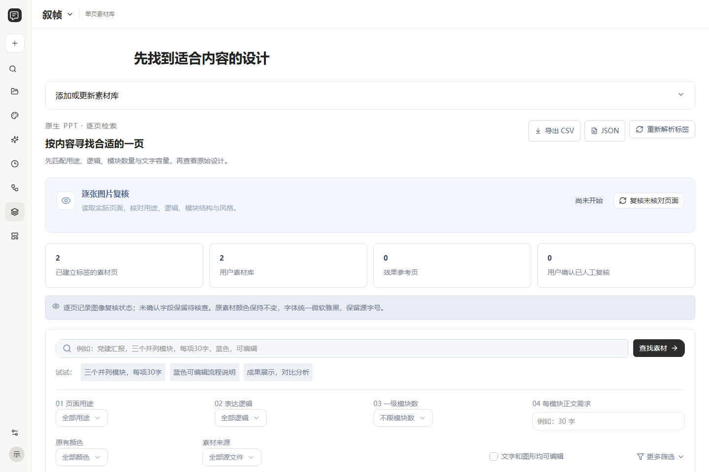

标签包括页面用途、表达逻辑、内容结构、文字容量、适用场景、视觉风格、编辑能力和复用条件。容量是基于实际文本框、字号和行数的估计，不能只按源页已有字数认定合理容量。缺少字体、图片、数据或资源时应记录待核查，不能因为文件扩展名是PPTX就宣称全部对象可编辑。

### 10.3 删除素材

管理员可以勾选多项素材后执行批量删除或相应管理操作。执行前核对所选数量和范围。删除可用素材可能影响后续推荐与旧任务恢复，不应在活动任务使用该素材时清理对应源文件。素材条目、源文件和已生成作品不是同一个对象，管理时应按界面提供的操作范围处理。

## 11 版式与Skills复用

### 11.1 选择已有版式

进入版式与Skills页，选择适合汇报类型的版式卡，查看其用途、参数和规则，再用于新演示。版式规则描述页面骨架、字号层级和内容组织方法；具体颜色和大小仍需遵守用户明确要求与真实源对象。科研答辩、工作汇报与培训材料的内容密度不同，不应仅更换配色就认为完成风格转换。

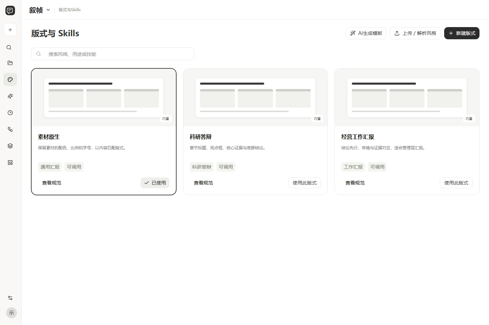

### 11.2 上传参考PPT与提示词

用户可上传参考PPT，让系统读取整套页面的原生对象、字体、字号、颜色和模块职责，并结合可用预览进行模型分析。分析失败时，版式会处于可重试状态，不能因为已上传文件就认为分析完成。未实际读取图片时，不会把几何推断标为视觉确认。

上传或编辑提示词可以补充标题规则、模块布局、图表标准和交付要求。提示词应说明适用场景、输入、输出和检查条件，避免同时要求所有页固定同一种版式，又要求按不同内容自由重排。编辑后保存，再将该版式选入新任务，已有任务仍应保持其使用的规则快照。

### 11.3 AI生成可复用模板

点击AI生成模板，填写名称、用途、版式数量、机构底稿和可选素材套系。系统从素材库中的真实可编辑组件选择和重组模板页，规划封面、目录、正文与结束页，填写具有明确用途的通用占位提示。模板不是某一份业务报告，不应复制素材中的项目成果或示例数据。

生成后查看各页预览、模块职责和检查状态。通过原生文字检查和全页预览后，可保存为个人可复用模板；Office检查或预览不完整时，只能按界面说明保存草稿或重试。模板窗口中的停止生成会保留方案和已完成页，之后可以从断点继续。

### 11.4 编辑全局制作规则

设置中的技能与规则集中展示写作、图表、素材、模板和检查等规则。修改规则前明确作用范围，避免把某一份文档中的临时要求写成所有作品默认要求。用户需求与文档事实优先，规则不能要求编造数据、缩小字号掩盖溢出或把整个页面图片当成可编辑交付。

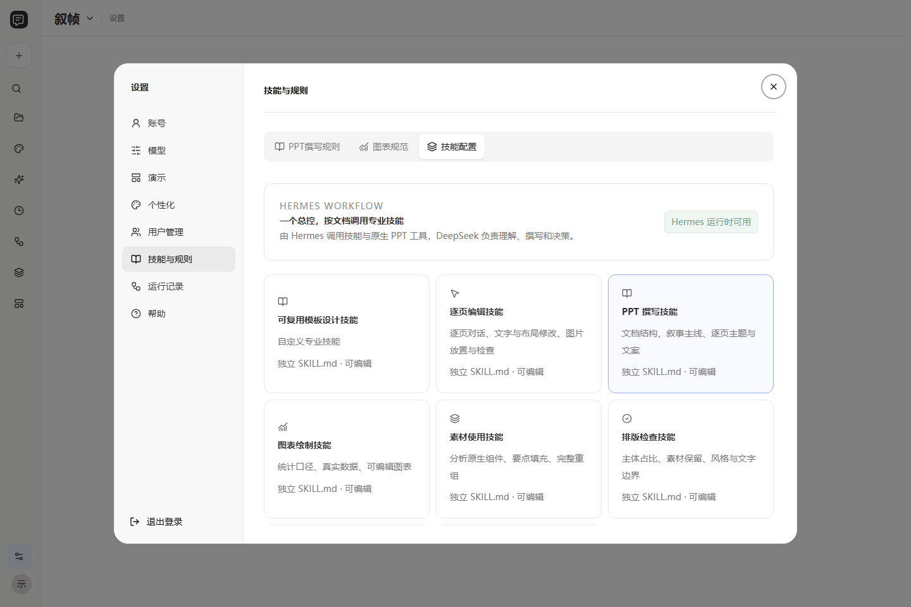

## 12 Hermes运行记录

### 12.1 查看任务与逐页对话

Hermes工作台提供逐页修改、任务运行以及框架与技能信息。逐页修改记录展示用户要求、照片、回复、所选对象和版本结果；选择一个版本可以比较修改前后。任务运行记录展示阶段、模型请求、工具事件与页面智能体状态，便于区分正在工作、检查中、停止和失败。

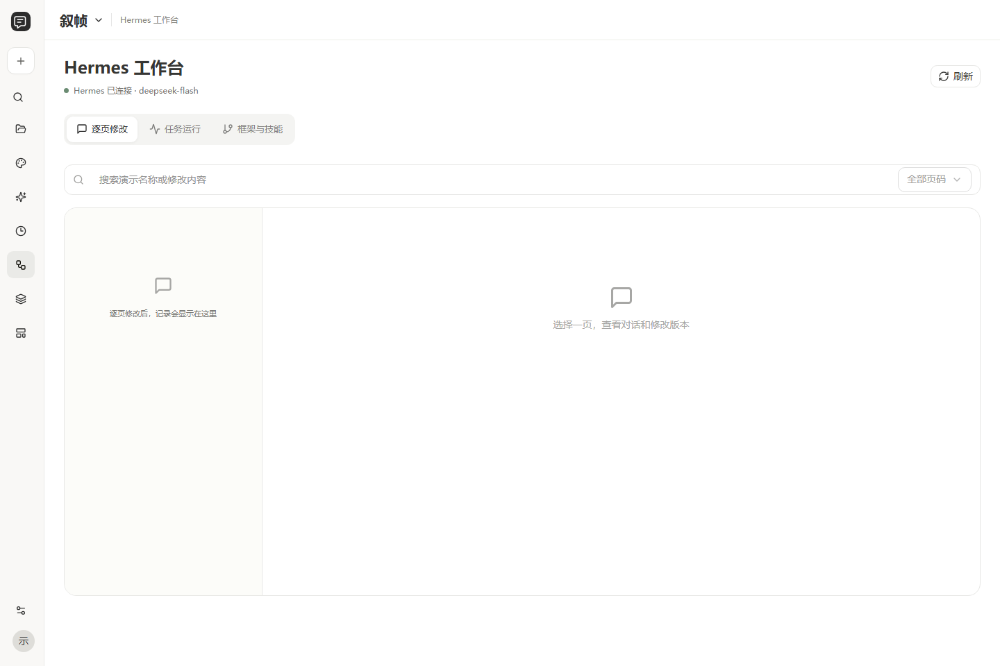

记录反映软件保存的执行信息，不等于显示模型内部完整思考过程。用户可以追踪公开的操作、工具结果与版本变化，但不能要求界面还原未记录的内部推理。框架信息用于了解Hermes接入与技能组织，不是直接替代软件的业务权限管理。

### 12.2 处理异常任务

任务失败时先查看具体阶段与错误，而不是反复重新生成整稿。模块缺失通常属于运行环境问题，额度不足属于账号限制，模型返回格式错误属于接口或输出问题，文字溢出属于页面适配问题。针对不同原因处理，避免把不相关的配置反复修改。

任务详情可停止自己发起的运行任务，已停止任务在可恢复时提供继续入口。需要人工选版时回到创作工作台处理对应页，查看已完成预览后再继续。不要删除正在恢复的任务所引用的底稿、素材或项目资料。

## 13 协作与远程演示

### 13.1 建立协作房间

作品拥有者从成稿界面的协作与演示进入房间，邀请已注册用户，并选择查看或编辑权限。加入房间后，查看者看到页面预览和评论，不获得完整原始文档、讲者备注或源文件编辑接口权限。只有相应权限的用户才能进入逐页编辑工作台。

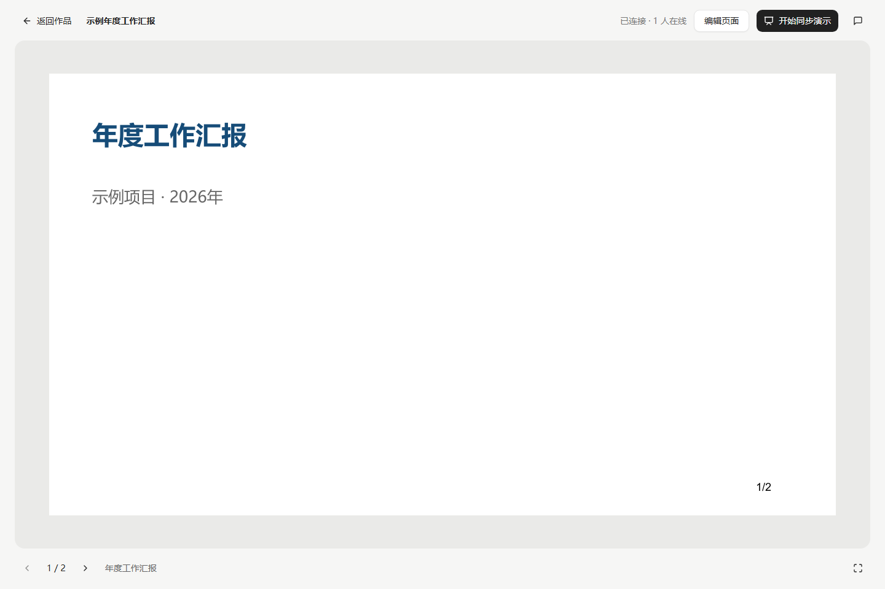

### 13.2 跟随翻页与评论

演示者开始同步后，其他成员可以跟随当前页。成员也可以暂时停止跟随自行浏览，再恢复跟随。软件通过服务器发送事件同步状态，网络恢复后读取最新快照。一次房间由一名当前主持者控制同步翻页，遇到主持冲突时先核对房间中的演示状态。

评论与具体页关联，可用于补充证据、提出修改意见或记录确认事项。评论不是直接修改PPT对象，实际改稿仍由编辑者进入逐页工作台完成。拥有者撤销成员权限后，该用户不能继续访问房间内容。协作功能不包含内置音视频会议，需要语音交流时使用独立会议工具。

### 13.3 可选云端连接

用户可按需将当前演示发送为Google Slides或飞书Slides的副本。连接需要目标服务的访问令牌与相应权限，是否完成取决于目标平台的实际返回。令牌只用于本次连接请求，不作为普通项目资料保存。

外部转换可能改变字体、动画或复杂对象，转换后需要复查。当前连接不会自动邀请外部人员、建立公开分享或双向覆盖本地源稿；也不等同于已经实现一键OAuth登录和自动续期。仅有局域网地址时，跨公网接收者仍需要能访问该部署的网络入口。

## 14 最近作品与回收站

### 14.1 查看和分类

最近作品支持搜索、文件夹分类和分页。点击作品卡片进入对应演示稿，返回作品后保留此前列表位置、分类和搜索状态。作品卡片中的分类用于调整归属项目，删除用于移入回收站，不需要额外点击继续查看按钮。

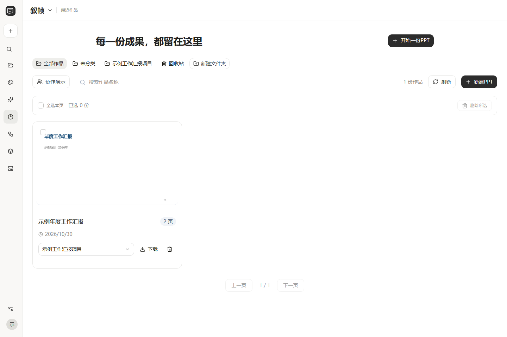

勾选多个作品可以批量操作。执行前核对搜索条件和所选范围，避免把搜索结果与整个项目混淆。界面中的作品标识与项目名称是不同字段，重命名项目不应当改变已有作品的版本标识。

### 14.2 恢复与永久删除

删除后的作品进入回收站，可按权限恢复。回收站有勾选项时针对所选项执行永久删除，没有选中项时可以清空当前可管理回收站范围；界面根据选择状态提供对应操作，避免两个相同动作同时混淆。永久删除应在核对目标后确认，不能依靠断点恢复已经清除的源文件。

作品版本链与服务器保存文件有关。永久删除处理对应的作品文件，不应移除其他账号的文件，也不应把用户任意选择的外部目录当成可递归清理的目标。需要长期保留时先下载PPTX或按项目备份，再清理回收站。

## 15 管理与个性化设置

### 15.1 用户管理

管理员在设置中的用户管理查看账号列表、创建用户、调整角色与状态、重置密码并管理生成额度。普通用户没有该入口，也不能直接调用管理接口取得权限。停用账号会阻止登录，移除账号与永久清理作品属于不同管理动作，不应混为一谈。

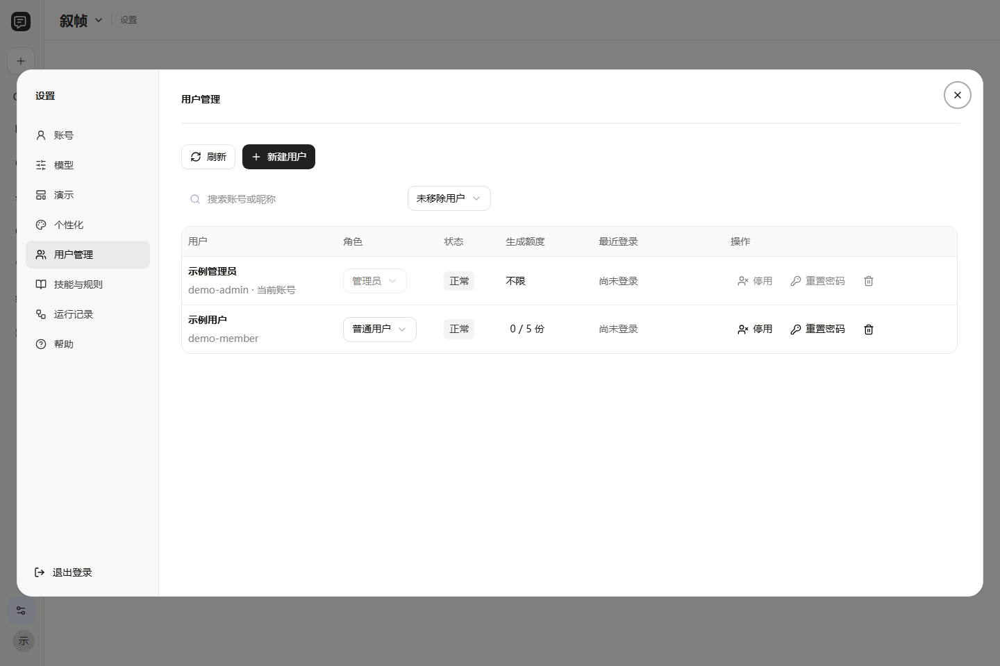

调整角色前核对账号身份，特别是避免误移除或停用最后一个可用管理员。重置密码后，通知对应用户通过约定渠道重新登录，并及时修改为个人密码。不能在公开说明书、截图或GitHub issue中公布真实密码和API Key。

### 15.2 个性化

个性化页面可调整侧栏状态、字号、减少动态效果与默认起始页面。设置影响当前账号的网页使用偏好，不直接修改PPT中源对象的字号和颜色。PPT字体属于演示规则与模板策略，应在相应制作配置中设置。

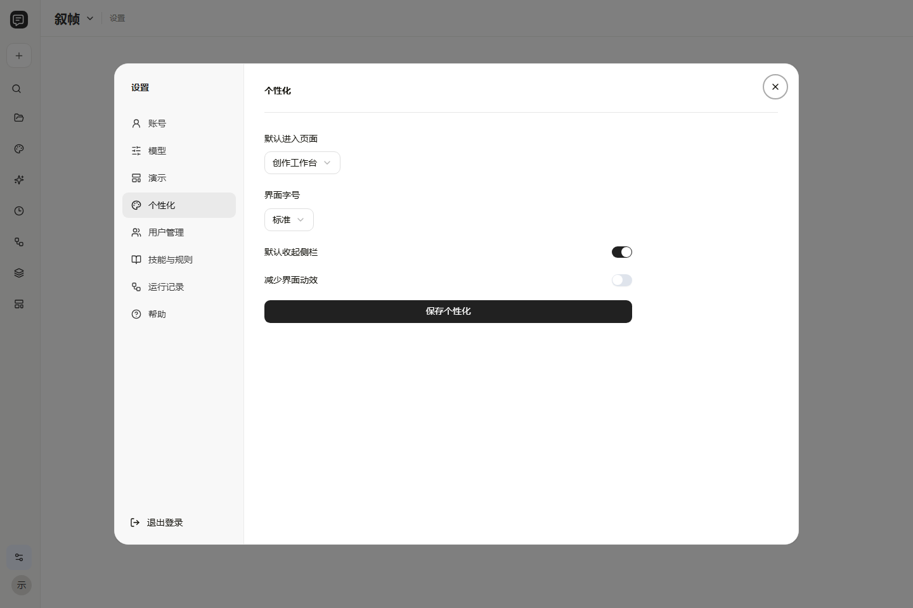

## 16 数据维护与故障处理

### 16.1 保存与备份

服务器data目录保存素材源文件、模板索引、账号、加密模型连接、作品、预览、单页会话和任务断点，项目目录保存用户选择位置下的资料与输出副本。代码仓库不能代替这些运行数据的备份。备份时应保留相互关联的版本文件、项目清单和加密密钥，避免只有索引没有实际PPTX。

升级前先结束活动任务，再备份配置、data目录和需要保留的项目目录。恢复时保持文件归属与相对路径一致，检查模型连接是否能够解密、模板与素材是否能够读取，并抽查已有作品的下载与单页编辑。不要将生产运行数据推送到公开仓库，也不要将备份包上传到公开下载位置。

### 16.2 网页白屏或页面异常

刷新后仍白屏时，打开浏览器控制台记录第一条错误，核对是否在更新后遗漏构建或前后端版本不一致。不要只根据压缩文件中的短变量名修改业务逻辑。应回到对应源码定位组件状态或接口返回，修复后重新构建，并验证受影响页面。保留原始文档和已生成文件，界面异常不等于这些文件已经丢失。

### 16.3 Hermes模块缺失

出现No module named hermes_bootstrap时，先运行诊断，检查HERMES_SOURCE_PATH是否指向完整Hermes源码目录，Python路径是否正确，以及四个核心文件是否存在。使用仓库安装脚本准备运行时，或修正已有环境路径。修好后读取任务状态，已保存的失败记录不会自动变成成稿，需要主动从断点继续。

### 16.4 模型连接与额度问题

接口返回401或403时检查Key和模型权限；429通常表示服务方限流，应降低并发或稍后重试。网络连接成功但工具调用失败时，核对接口兼容性。应用生成额度不足时联系管理员调整，不要通过删除作品或反复新建相同任务尝试绕过限制。失败重试前先确认已停止旧任务，避免重复请求。

### 16.5 文字溢出与素材不适配

错误会指明页码、文字槽和超出内容。短标签只有一两个字仍溢出时，优先检查缩放后的文本框尺寸与源页标题是否被误识别，不能继续无意义缩写。长段文字应精简为与模块主题对应的要点；必要时选择容量更大的版式，或让系统重组本页模板。修复后重新检查对象完整性、原字号边界和全页预览。

### 16.6 Office不可用与预览未完成

无法执行原生检查时，确认桌面PowerPoint已正确安装并完成首次初始化，检查文件是否被占用，以及部署账号是否可以执行Office自动化。不要同时启动多个外部Office批处理来争用同一文件。系统会区分检查不可用与真实溢出；未完成必要检查时，应处理环境并重试，不把未检查结果标为通过。

### 16.7 版本冲突与文件同步

同页被其他编辑者修改时，重新读取最新页面再提交要求。不同页会在整稿合并队列中保留各自修改，但旧页面指纹不能跨新版本继续使用。项目latest.pptx被占用时，先关闭该文件再检查同步；独立版本文件与系统下载记录仍用于确认已经保存的成果。遇到恢复签名不一致，应核对模板与素材变更，不手工改写断点跳过校验。

### 16.8 交付前检查

正式汇报前，确认目录和页眉来自真实章节，页面标题简明，模块标题与正文相关，数据来源和单位清楚，图片比例正确，字体在汇报电脑可用。对采用外部Slides转换的副本再次检查。检查无误后交付当前版本，保留原始资料与关键版本，方便后续追溯和修改。

汇报结束后，按实际需要收回临时协作者权限，检查公开分享与外部副本的保留范围。需要后续复用的版式应保存清楚的模块用途和容量说明，业务数据与个人照片仍保留在对应项目，不写入全局模板的默认文案。再次生成其他主题时，重新核对事实来源与章节结构，不能沿用上一份作品的结论作为默认结果。
